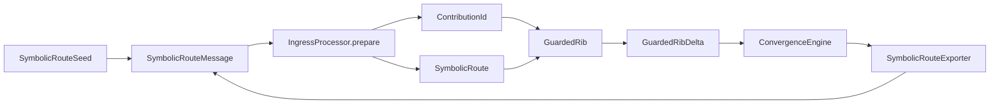
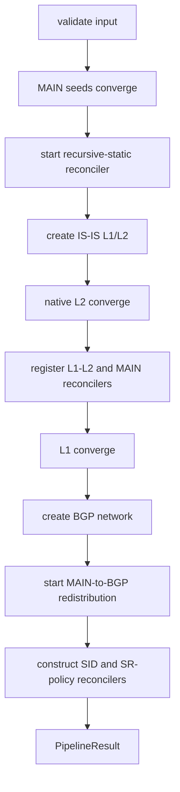

# Symbolic Route 实现级代码导读

## 1. 先建立正确的对象模型

### 1.1 证据口径

本文结论只来自以下两组源码：

- `src/main/java/org/batfish/minesweeper/symbolicroute/*.java` 的字段、构造器和方法体；
- `src/test/java/org/batfish/minesweeper/symbolicroute/*Test.java` 的输入、调用和断言。

现有 README、架构说明和 TODO 不作为实现事实来源。代码中能够直接观察到的行为写作“实现”；
只能由结构推断、但没有测试断言支持的内容会明确写作“推断”。

本包不是把 Batfish route 的每个字段都符号化，而是把“具体路由属性”和“该路由成立的布尔条件”
组合起来。理解代码时必须区分三层对象：

| 层次 | 类型 | 含义 |
| --- | --- | --- |
| 具体路由 | `AbstractRouteDecorator` / `AnnotatedRoute<?>` | prefix、protocol、metric、next hop 等 Batfish 属性 |
| 符号候选 | `SymbolicRoute<R>` | 具体路由 + availability guard + identity + provenance |
| RIB 视图 | `GuardedRibEntry<R>` | 符号候选 + 动态计算的 selection guard |

完整流转关系：



最重要的四个概念：

1. `SymbolicRouteKey` 标识一个 RIB candidate；
2. `SymbolicRouteContributionId` 标识支持 candidate 的一条有向通告；
3. availability guard 表示 candidate 在什么条件下存在；
4. selection guard 表示排除所有严格更优 candidate 后，它在什么条件下被选中。

## 2. Guard 的实现

### 2.1 `RouteGuard`

核心代码只依赖该接口：`and/or/not` 构造公式，`simplify` 简化，`isSatisfiable` 判断是否可能
成立，`isEquivalentTo` 判断两次状态是否语义相同。更新检测不能比较字符串，因为结构不同的
公式可能逻辑等价。

### 2.2 `BooleanGuardAst`

它是可序列化的 solver-independent 树：

```text
operator = TRUE | FALSE | VARIABLE | NOT | AND | OR
variableId = VARIABLE 节点的名称
children = NOT/AND/OR 的不可变子节点
```

`and(Iterable)`/`or(Iterable)` 建立规范结构，`canonicalForm()` 生成稳定形式，
`getVariables()` 递归收集变量。它负责持久化和跨 Z3 context 重建，不负责完整 SAT 求解。

### 2.3 `AstRouteGuard`、`Z3RouteGuard`、`Z3RouteGuardFactory`

- `AstRouteGuard`：不启动 solver 的轻量实现；
- `Z3RouteGuard`：同时持有 Z3 expression 和 AST，负责 SAT、逻辑等价和 k-failure 查询；
- `Z3RouteGuardFactory`：保证 guard 共用同一 `Context`，并可从 AST 重建 expression。

对应测试：`BooleanGuardAstTest` 的 canonical/JSON 用例，以及 `GuardedRibTest` 的 guard algebra、
at-most-k-failure 用例。

## 3. 四种身份为什么必须分开

### 3.1 Candidate identity：`SymbolicRouteKey`

实际字段是 `router + vrf + complete concrete route`。protocol 和 network 只是从 route 派生的
getter。`equals/hashCode` 比较完整 route，所以同 prefix 但 metric、next hop 等不同的路由是不同
candidate。

`toString()` 只显示 router/VRF/protocol/prefix，比真实 identity 粗，绝不能代替 Map key。

### 3.2 Contribution identity：`SymbolicRouteContributionId`

字段是 `messageId + sender + receiver`。它表示某个邻居的某条通告，而不是 candidate。本地 seed
使用 `sender == receiver == originRouter`。

两条通告经过 import 后可以生成同一个 key：

```text
K -> {
  C1(sender=R1, receiver=R2) -> route guard L12,
  C2(sender=R3, receiver=R2) -> route guard L23
}
```

此时 candidate availability 为 `L12 OR L23`。撤回 C1 只移除 L12，不会删除 C2。

### 3.3 Session identity：`SymbolicRouteSession`

字段为 sessionId、sender、receiver、linkGuard、可选 `LinkFailureKey`。session 有方向，物理链路
failure key 无方向。构造器拒绝自环，也拒绝与 endpoint 不一致的 failure key。

### 3.4 Message identity：`SymbolicRouteMessage`

消息还携带 route、guard、provenance 和 `EGRESS/INGRESS` stage。Ingress processor 只接受
`INGRESS`，避免未完成 export/link 处理的对象直接进入 RIB。

Factory 先把 adapter message id 放入 session namespace；Exporter 再把 parent contribution 编入
branch id。因此平行 session 和同 candidate 的不同 provenance branch 不会互相覆盖。

## 4. `SymbolicRoute` 和 provenance

`SymbolicRoute<R>` 的四个不可变字段是 key、route、availabilityGuard、provenance。构造器强制
`key.getRoute().equals(route)`。`withAvailabilityGuard` 创建新对象而不是原地修改，保证 RIB 能保留
可信的 before/after 快照。

`SymbolicRouteProvenance` 保存 origin、current、previous、incoming interface、router path 和 parent
message id。构造器要求 path 首节点等于 origin、末节点等于 current。Exporter 每跨一跳复制 path，
追加 receiver，并更新 current/previous。

Provenance 参与 `SymbolicRoute.equals`，但不参与 candidate key。因此多来源 route 可以共享 candidate，
同时保留各自路径。

## 5. `GuardedRib` 的内部状态

这是最核心的数据结构，包含三个权威 Map：

```java
Map<SymbolicRouteKey, SymbolicRoute<R>> _routes;
Map<SymbolicRouteKey,
    Map<SymbolicRouteContributionId, SymbolicRoute<R>>> _contributions;
Map<SymbolicRouteContributionId, String> _contributionSessionIds;
```

- `_contributions` 保存原始贡献事实；
- `_routes` 保存按 key 合并后的 candidate；
- `_contributionSessionIds` 为无损控制面输出保留 session。

### 5.1 `putContribution` 算法

```text
before = computeEntries()
找到 _contributions[key]
if guard satisfiable:
    写入 contribution；同步 sessionId
else:
    删除 contribution 和 sessionId
rebuildCandidate(key)
after = computeEntries()
return changedEntries(before, after)
```

`rebuildCandidate` 在没有贡献时删除 candidate；否则选一个 contribution 作为 representative，检查
所有贡献的 concrete route 相同，然后 OR 全部 availability guard。不同 payload 被放到同一 key 时
直接抛异常。

### 5.2 selection guard 算法

`computeEntries()` 对每个 candidate 扫描全部 candidate：

```text
selection = candidate.availability
for higher in all candidates:
    if same router, VRF, prefix
       and comparator(higher.route, candidate.route) < 0:
        selection = selection AND NOT higher.availability
return simplify(selection)
```

comparator 返回 0 的等优先级 route 不互相抑制，因此保留 ECMP。不同 VRF、router、prefix 不参与
互斥。当前算法每次 mutation 都全量计算 before/after，约为候选数平方，设计重点是语义清晰而非
局部增量优化。

### 5.3 Candidate view 与 contribution view

- `getEntries/get(key)` 返回 candidate 级视图，availability 是贡献 OR；
- `getContributionEntries(key)` 分别计算每个来源的 selection branch；
- Exporter 使用 contribution view，最终 RIB 汇总可使用 candidate view。

例如候选 K 有 L12、L23 两个来源，并存在更优候选 H：

```text
candidate selection = (L12 OR L23) AND NOT H
C1 branch selection = L12 AND NOT H
C2 branch selection = L23 AND NOT H
```

### 5.4 Delta

`changedEntries` 比较前后状态：新增产生 `ADDED`，消失产生 `REMOVED`，availability 或 selection
不逻辑等价产生 `GUARDS_CHANGED`，逻辑等价则 no-op。这保证重复通告和公式等价重放不会继续传播。

推荐按顺序阅读 `GuardedRibTest`：availability/selection 区分 → equal preference → 多 contribution
OR/独立撤回 → higher guard 更新 → arrival-order independence → unsatisfiable replacement → VRF 隔离。

## 6. Ingress 的两阶段处理

`SymbolicRouteIngressProcessor.prepare(message)`：

```text
校验 stage == INGRESS 和 receiver 匹配
执行 ingressPolicy
denied -> empty
accepted -> 得到可能被策略修改的 route
用 keyFactory(receiver, route) 创建 key
校验 key.router == receiver
创建 SymbolicRoute 和 ContributionId
返回 PreparedCandidate
```

`install(prepared)` 才调用 `rib.putContribution`。

拆成两步是为了让 engine 在修改 RIB 前验证：同一 contribution identity 不能突然映射到另一个
candidate key。route replacement 必须显式使用新 contribution id。

## 7. Export 的逐步实现

`SymbolicRouteExporter.export(entry, parent)`：

```text
校验 entry.key.router 和 provenance.currentRouter 都等于 sender
执行 egressPolicy；deny 则停止
messageGuard = entry.selectionGuard AND linkGuard
guard 不可满足则停止
生成带 session namespace 和 parent branch 的 messageId
childId = (messageId, sender, receiver)
dependencies.replaceParents(childId, [parent])
复制 provenance path 并追加 receiver
返回 Stage.INGRESS 的 child message
```

这里必须使用 selection guard，而不是 availability：route 存在但未被选中时不能传播。

`SymbolicRoutePropagationDependencies` 双向保存 parent→children 和 child→parents。`replaceParents`
先删旧入边再加新边，防止重导出留下脏依赖。注意：当前 engine 的撤回调度权威索引是自己的
advertisement/location maps；dependency graph 主要保存可审计、可导出的因果关系。

## 8. Convergence Engine 的运行时索引

```java
receiver -> IngressProcessor
sender -> outgoing Exporters
ContributionId -> ContributionLocation(receiver, key, guard)
Exporter -> CandidateKey -> ParentContributionId -> AdvertisementRecord(childId, guard)
stableStateListeners
```

FIFO `WorkItem` 有 `ADVERTISE(message)` 和 `WITHDRAW(id, expectedGuard)` 两种。withdraw 保存 expected
guard，是为了阻止旧撤回删除已经用新 guard 重装的 contribution。

### 8.1 `processAdvertisement`

1. 找 receiver processor；
2. 从 message 派生 contribution id；
3. `prepare` 被 deny 时，若旧 contribution 存在则删除，否则 no-op；
4. accepted 时检查同一 id 没有迁移到不同 key；
5. install 并更新 location；
6. 调用 `propagateDelta`。

### 8.2 `propagateDelta`

对每个变化 candidate 和每个 outgoing exporter：

1. 删除该 candidate 的旧 advertisement records；
2. 对旧 child 删除 dependency，并入队 withdrawal；
3. 若 candidate 仍存在，从 RIB 读取所有 contribution entries；
4. 每个分支重新 export；
5. 记录 child advertisement 并入队 advertise。

Guard change 也采用 withdraw + re-advertise。FIFO 顺序与 expectedGuard 检查共同避免旧撤回误删新状态。

### 8.3 `replace`

先校验 old 存在、new id 未使用、新旧 id 不同，再在同一队列中依次放 old withdrawal 和 new
advertisement。它是经过预校验的有序替换，不是带回滚的数据库事务。

### 8.4 稳定态

队列完全排空后才同步执行 listeners。Pipeline 用稳定边界连接 L1→L2、协议 RIB→MAIN、
MAIN→static/BGP redistribution，以及 underlay→SID/SR policy。

## 9. NetworkFactory 如何装配对象

`SymbolicRouteNetworkFactory.create`：

1. 每个 router 创建 `GuardedRib(adapter.preferenceComparator(router))`；
2. 每个 router 创建 ingress processor；
3. 创建全网共享 dependency graph；
4. 每个 directed session 创建 exporter；
5. 校验 router、session id、seed contribution id 不重复；
6. seed 转成 sender=receiver=origin 的 INGRESS message；
7. 创建 engine 并封装为 `SymbolicRouteNetwork`。

`SymbolicRouteNetwork` 只保存 engine、不可变 RIB registry、initial advertisements 和 dependencies。
稳定状态下重复 `converge()` 应因逻辑等价判断成为 no-op。

## 10. 顶层 Batfish Pipeline

Pipeline 创建四个独立 network：MAIN、IS-IS L1、IS-IS L2、BGP。真实顺序是：



`validate` 在任何状态修改前检查 configuration/hostname、concrete MAIN RIB、edge/session 集合和
endpoint、redistribution target BGP process、seed/static router。策略是 fail-fast，而不是返回部分
成功的控制面。

Adapter 负责“一条消息怎样转换”；Reconciler 负责“两个稳定 plane 之间长期如何增量同步”：

| 组件 | source → target |
| --- | --- |
| `BatfishMainRibReconciler` | IS-IS/BGP selected branch → MAIN |
| `BatfishIsisLevelTransitionReconciler` | L1 selected candidate → L2 contribution |
| `BatfishStaticRouteReconciler` | MAIN stable state → recursive static fixed point → MAIN |
| `BatfishBgpRedistributionReconciler` | MAIN connected/static → BGP |
| `BatfishRedistributionReconciler` | 一条 policy result → advertise/withdraw/replace |

核心 engine 不读取 BGP local preference 或 IS-IS metric；这些具体语义由 Batfish adapter 和 RIB
comparator 提供。

### 10.1 `BatfishMainRibReconciler` 的实际 diff

源码中的 `SourceKey` 由 `plane + source SymbolicRouteKey + source ContributionId` 组成。它避免同一
协议 candidate 的不同 provenance branch 在 MAIN 中合并成一个生命周期。`TypedSource.collect`
遍历 source network 的每个 RIB、candidate 和 contribution entry，并过滤：

```text
eligible predicate 为 false
或 concrete route.nonRouting
或 selectionGuard 不可满足
```

剩余分支被转成 `DesiredMainRoute(route, selectionGuard, provenance)`。`reconcile()` 先比较 `_active`
与 desired：desired 消失或 route payload 改变时先 withdraw；随后为新增、route 改变或 guard 不等价
的项发送本地 INGRESS message。`_messageIds.computeIfAbsent` 让相同 SourceKey 的 guard 更新保持
message identity 稳定。

### 10.2 `BatfishStaticRouteReconciler` 的实际防重入结构

构造器只接受 `NextHopIp` static route，并校验 candidate key、contribution id 唯一，且 MAIN 中尚未
预装该 owned candidate。`_activeGuards` 初始值使用 `configured AND NOT configured` 构造逻辑 false，
而不是假设某种具体 guard 实现。

`start()` 的顺序是：先 reconcile，成功后注册 stable listener，再 reconcile 一次关闭注册窗口。
`reconcile()` 使用 `_reconciling/_pending`：同步 listener 在本轮 MAIN 更新期间再次触发时只设置
pending，外层 `do/while` 随后重算，不递归进入自身。

每轮 `computeLeastFixedPoint()` 会排除 reconciler 自己拥有的 route，从当前 MAIN 创建 scratch
network，再调用 `BatfishStaticRouteResolver.resolveToFixedPoint`。这避免上次 static 结果成为下一次
计算的陈旧输入。

### 10.3 BGP 与 IS-IS adapter 从方法体可见的差异

`BatfishBgpProtocolAdapter` 为每个 router/VRF 构造 `Bgpv4Rib` preference oracle。Import 依次执行
Batfish `transformBgpRouteOnImport` 和 receiver import policy；export 依次执行 pre-export transform、
sender export policy、post-export transform。缺失 import policy 表示直接接受 transformed route，
但缺失 export policy 会拒绝导出——这是当前方法体的明确非对称行为。

`BatfishIsisProtocolAdapter` 构造时拒绝 `LEVEL_1_2`，因为一个 adapter 只承载一个 level，并要求
edge 两端该 level 都是 ACTIVE。Import 会检查路径中 receiver 出现次数以阻断回路，然后增加接收
接口 cost、设置 next-hop 为 sender interface address，并重算 admin。Export 本身不改 route，只
检查 level 和 sender VRF。

## 11. 测试驱动的阅读顺序

| 阶段 | 测试 | 对照生产代码 |
| --- | --- | --- |
| 数据模型 | `SymbolicRouteModelTest`、`BooleanGuardAstTest`、`LinkFailureKeyTest` | key、route、message、provenance、guard、link identity |
| RIB 公式 | `GuardedRibTest` | put/remove、rebuildCandidate、computeEntries、changedEntries |
| 单跳 | `SymbolicRouteIngressProcessorTest`、`SymbolicRouteExporterTest` | prepare/install、export、dependency |
| 多跳/撤回 | `SymbolicRouteConvergenceEngineTest` | queue、stale withdrawal、recursive update、replace |
| 装配 | `SymbolicRouteNetworkFactoryTest` | router/session/seed validation 与 wiring |
| Batfish 语义 | `BatfishRoutingPolicyProcessorTest`、`BatfishProtocolSemanticsTest`、`BatfishBgpProtocolAdapterTest` | policy、preference、LPM、static、BGP |
| IS-IS | `BatfishIsisAlgorithm2Test`、`BatfishIsisLevel2PipelineTest` | L1/L2、ECMP、attach、incremental reconcile |
| 完整 pipeline | `BatfishSymbolicRoutePipelineTest`、`ToleranceFourRouterParsedPipelineTest`、`TrafficDemoSingleLinkFailureTest` | 输入校验、全网收敛、与 concrete dataplane 对照 |

## 12. 实现审计时最容易漏掉的点

1. candidate key 包含完整 route；其 `toString()` 不是完整 identity。
2. candidate availability 是贡献 guard 的 OR；单个来源撤回不能删除其他来源。
3. selection 排除严格更优 route，等价优先级不互斥。
4. guard 更新使用逻辑等价，不使用对象或字符串相等。
5. candidate provenance 取 representative；逐来源路径必须读 contribution entries。
6. 同一 contribution 不能迁移 candidate；payload replacement 必须换 id。
7. Engine 依靠 advertisement/location maps 调度撤回，dependency graph 不是唯一调度索引。
8. stable listeners 同步且有注册顺序；新增跨 plane listener 必须补集成测试。
9. `computeEntries()` 是全量二次扫描；优化不能破坏到达顺序无关、ECMP 和 VRF/prefix scope。
10. 报告 DTO、展示简化和排序都不能回流为控制面 identity。
